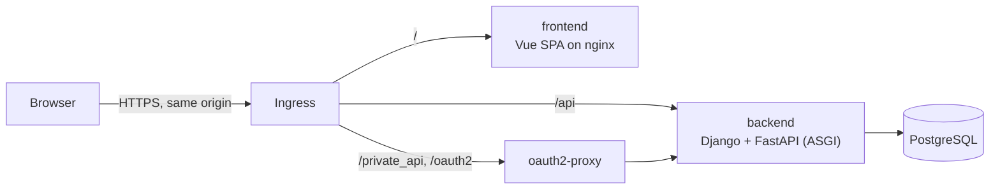

# Application structure

**Status**: Accepted

## Context

A new startup needs to put something in front of users quickly, run cheaply on
infrastructure its owner controls, and grow without a rewrite. These choices
are made once by the template so a project can start with its product, and are
recorded here so they can be revisited deliberately.

## Decision

1. **One repository** holds every service (`backend`, `frontend`, `e2e_tests`,
   `oauth2-proxy`, `deployment`). An API change and its UI change are one
   commit and one review.
2. **Backend: Django and FastAPI in one ASGI application.** Django provides the
   ORM, migrations and admin; FastAPI provides typed HTTP routes and the OpenAPI
   schema. Routes stay thin and business logic lives in services.
3. **Frontend: a Vue + TypeScript single-page application** built to static
   files and served by nginx. TanStack Query owns server state. The API client
   is generated from the backend's OpenAPI schema, so the schema is the only
   coupling between the two services.
4. **Same origin for everything.** The ingress routes `/api`, `/private_api`
   and `/oauth2` on the frontend's domain, so there is no CORS and the session
   cookie is never readable by JavaScript.
5. **Authentication at the edge.** OAuth2 Proxy runs the OIDC flow and holds
   the session; `/private_api` is reachable only through it. The backend trusts
   the proxy's Authorization header and never handles passwords or tokens.
6. **PostgreSQL** for all persistent data; schema changes go through Django
   migrations.
7. **Deployment** to the owner's Hetzner servers running k3s, provisioned and
   deployed by the startup CLI with shared Ansible roles.

## Consequences

- One stack to learn, one deploy pipeline per service and no cross-origin
  configuration.
- Frontend and backend deploy independently but must stay compatible through
  the generated client, which CI checks for drift.
- The frontend has no server-side rendering. A public, SEO-relevant area would
  need a separate decision (for example a pitch page or SSR).
- Login depends on an OIDC provider; local development and E2E use a local
  OIDC stand-in.

## Alternatives considered

- **Django alone (templates and DRF):** fewer moving parts, but no generated
  typed client and a weaker split between UI and API.
- **Next.js or Nuxt with SSR:** better for public SEO pages, but adds a Node
  server per project for little benefit behind a login.
- **Separate repositories per service:** independent releases, at the cost of
  versioned API artifacts and coordinated cross-repository changes.
- **Managed platform (PaaS):** less operations work, but less owner control and
  higher cost as the startup grows.
